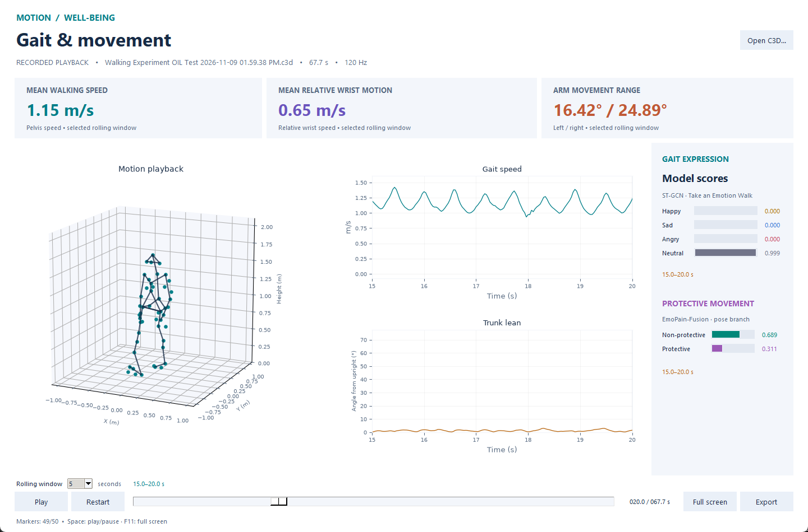

# Mocap Well-being Showcase

Windows desktop demo: C3D playback, gait speed, trunk lean, and pretrained
emotion/protective-movement scores. Runs locally with a 3-15 second rolling window.



| Area | What it shows |
|---|---|
| Top cards | Mean walking speed, wrist motion relative to the pelvis, and left/right arm movement range over the selected window. |
| Left | 3D body markers at the current playback time. Drag to rotate. |
| Centre charts | Gait speed (m/s) and trunk lean from upright (degrees) over time. |
| Right: Gait expression | Happy, Sad, Angry and Neutral model scores. These independent scores need not sum to 1. |
| Right: Protective movement | Non-protective and Protective model scores. |
| Bottom | Rolling-window length, playback timeline, time counter and export controls. |

## Setup and run

Install [Python 3.13, 64-bit](https://www.python.org/downloads/windows/) with pip,
Tcl/Tk and the Python launcher, plus [Git for Windows](https://git-scm.com/download/win).

In PowerShell:

```powershell
git clone https://github.com/lalasray/mocap-wellbeing-showcase.git
cd mocap-wellbeing-showcase
.\setup_demo.bat
.\launch_demo.bat
```

Setup requires internet for dependencies and model weights. Run it once;
subsequent launches work offline. Choose your C3D when the file picker opens.

You can also drag a C3D onto the launcher or run:

```powershell
.\launch_demo.bat "C:\Recordings\My recording.c3d"
```

With no argument, the app opens a C3D from its folder or shows a file picker.
Use **Open C3D...** to switch files. Rerun `setup_demo.bat` to repair installation.

## C3D requirements

Single-subject **OptiTrack/Motive full-body markers**, **Z up**, units m/cm/mm.
Labels need a subject prefix, e.g. `Subject:ChestTop`, and these short names:

```text
ChestTop BackTop HeadFront HeadLeft HeadRight HeadTop
WaistLFront WaistLBack WaistRFront WaistRBack
LShoulderTop LElbowOut LWristIn LWristOut LHandIn LHandOut LHeel LKneeOut LToeTip
RShoulderTop RElbowOut RWristIn RWristOut RHandIn RHandOut RHeel RKneeOut RToeTip
```

Other marker layouts require adapter changes. Recordings are not included.

## Use the demo

1. Click **Open C3D...** (top right) and select a compatible recording.
2. Click **Play**. Watch the body, measurements and model scores update together.
3. Set **Rolling window** to 3-15 seconds. At 20 seconds, a 5-second window covers 15-20 seconds.
4. Pause and drag the timeline to inspect a moment. Click **Export** to save the current results.

- **Space:** play/pause. **Timeline:** seek. **Window:** 3-15 seconds.
- **Drag 3D view:** rotate. **F11:** fullscreen. **Escape:** exit fullscreen.
- **Export:** saves CSV measurements, JSON model scores and a plot to `outputs/`, overwriting previous exports.

Scores wait for a full window and animate toward each prediction. Exports contain
raw scores. Marker-to-model mapping is approximate; scores are not validated health assessments.

## Update

Close the app, then run from the repository folder:

```powershell
git pull
.\setup_demo.bat
.\launch_demo.bat
```
